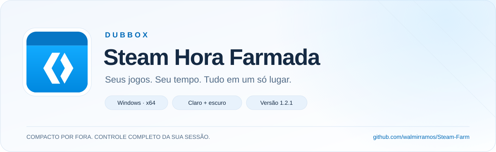

<div align="center">

<picture>
  <source media="(prefers-color-scheme: dark)" srcset="assets/readme/hero-dark.svg">
  <source media="(prefers-color-scheme: light)" srcset="assets/readme/hero-light.svg">
  
</picture>

<br>

**Uma janela compacta. Seus jogos organizados. Sua sessão sob controle.**

Gerencie sessões Steam com temas claro e escuro, tempo local e controles por jogo.

<br>

<a href="https://github.com/walmirramos/Steam-Farm/raw/refs/heads/main/Release/Steam-Hora-Farmada-v1.2.1.zip"></a>

**v1.2.1** · Windows x64 · .NET Framework 4.8 · Pacote ZIP

[Primeiros passos](#-primeiros-passos) &nbsp; · &nbsp; [Recursos](#-feito-para-sua-sessão) &nbsp; · &nbsp; [Compilação](#-para-quem-desenvolve) &nbsp; · &nbsp; [Reportar problema](https://github.com/walmirramos/Steam-Farm/issues)

</div>

<br>

## ✦ Feito para sua sessão

| Aparência que acompanha você | Controle por jogo | Leve na interação |
| :--- | :--- | :--- |
| **Claro ou escuro.** Escolha seu tema; a preferência é salva para a próxima abertura. | **Uma linha por AppID.** Veja o status e o tempo local. Pare um jogo ou toda a sessão. | **Inicialização assíncrona.** A janela continua respondendo enquanto os jogos são iniciados. |
| **Compacto por escolha.** Janela fixa de 660 × 574 unidades lógicas, sem maximização. | **Sem duplicação.** IDs repetidos são ignorados e jogos já ativos são mantidos. | **Cancelamento simples.** Parar todos também cancela os jogos que ainda estão na fila. |

<br>

## ↓ Primeiros passos

1. **Baixe e extraia** o [pacote v1.2.1](https://github.com/walmirramos/Steam-Farm/raw/refs/heads/main/Release/Steam-Hora-Farmada-v1.2.1.zip) para uma pasta.
2. **Abra a Steam** e entre na sua conta.
3. **Execute `SteamHoraFarmada.exe`** dentro da pasta extraída.
4. **Informe os AppIDs** e clique em **Iniciar jogos**.

```text
730, 440, 570
```

Você pode separar os IDs por vírgula, espaço, ponto e vírgula ou quebra de linha. Mantenha o auxiliar, as bibliotecas e os arquivos de configuração juntos ao executável.

> [!NOTE]
> O contador mostra o **tempo local desta sessão**, não as horas creditadas pela Steam. O status **Em execução** indica que o processo auxiliar está ativo.

<br>

## ◈ Pequenos detalhes, mais cuidado

- **Tempo sem reiniciar a cada dia:** o contador continua após 24 horas.
- **Cada sessão no seu lugar:** o encerramento afeta apenas os processos iniciados pela própria janela.
- **Saída com confirmação:** ao fechar uma sessão ativa, o aplicativo pergunta antes de parar seus jogos.
- **Diagnóstico acessível:** o botão **Ver registro** abre o log no Bloco de Notas.
- **Preferências preservadas:** AppIDs e tema da versão 1.2.0 continuam disponíveis na 1.2.1.

<details>
<summary><strong>Onde ficam meus dados e preferências?</strong></summary>

As preferências e os registros ficam em:

```text
%LOCALAPPDATA%\BDKSteamHourFarm-Modern
```

O nome interno da pasta foi mantido para preservar os dados da versão modernizada anterior. Os AppIDs da interface original, anterior à 1.2.0, não são importados automaticamente: informe-os uma vez.

</details>

<br>

## ◇ Identidade Dubbox

<table>
<tr>
<td width="140" align="center"></td>
<td>
<strong>Steam Hora Farmada · v1.2.1</strong><br><br>
Marca Dubbox, título em português e ícone redesenhado do zero em vetor, com fundo transparente e dez tamanhos para Windows, de 16 a 256 px.<br><br>
O mesmo ícone acompanha o executável e a janela.
</td>
</tr>
</table>

O visual desta apresentação é inspirado no Fluent Design e no WinUI 3. O aplicativo é desenvolvido em **Windows Forms com .NET Framework 4.8**.

<details>
<summary><strong>Arquivos de marca e regeneração do ícone</strong></summary>

| Arquivo | Uso |
| :--- | :--- |
| [`assets/dubbox.svg`](assets/dubbox.svg) | Original vetorial editável |
| [`assets/dubbox.png`](assets/dubbox.png) | PNG com transparência, 512 × 512 px |
| [`Source/SteamIdleManager/logo.ico`](Source/SteamIdleManager/logo.ico) | Ícone do Windows com dez tamanhos |
| [`tools/render-icon.cjs`](tools/render-icon.cjs) | Geração do PNG e do ICO a partir do SVG |

Com Node.js e o pacote `sharp` disponível, execute na raiz do repositório:

```shell
node tools/render-icon.cjs
```

</details>

<br>

## ⌘ Para quem desenvolve

<details>
<summary><strong>Compilar a interface</strong></summary>

Use um SDK .NET com suporte a projetos SDK-style e os assemblies de referência do .NET Framework 4.8. A entrega foi compilada com o **SDK .NET 10.0.403**.

Na raiz do repositório:

```powershell
Expand-Archive -LiteralPath '.\Release\Steam-Hora-Farmada-v1.2.1.zip' -DestinationPath '.\build\runtime' -Force
.\build-modern.ps1 -RuntimeDirectory '.\build\runtime\Steam-Hora-Farmada'
```

O resultado fica em:

```text
Source/SteamIdleManager/bin/Release/net48/SteamHoraFarmada.exe
```

O parâmetro `RuntimeDirectory` copia o auxiliar e suas dependências para a saída. O pacote conserva os componentes auxiliares da versão original.

</details>

<details>
<summary><strong>Executar os testes e conhecer a validação</strong></summary>

```powershell
.\test-modern.ps1
```

São **21 verificações** com um processo auxiliar simulado, sem iniciar jogos reais:

- Validação e deduplicação de AppIDs.
- Contador acima de 24 horas e dependências ausentes.
- Início, reinício e parada individual ou coletiva.
- Saídas normais e com erro.
- Cancelamento e preservação de outras instâncias.

A lógica da versão 1.2.0 passou nas 21 verificações. A atualização visual 1.2.1 foi compilada sem erros ou avisos e teve seus nomes e ícone conferidos na interface real. Os temas claro/escuro e a entrada vazia também foram inspecionados durante a modernização.

O crédito de horas na Steam e a escala em múltiplos monitores não foram testados.

</details>

<details>
<summary><strong>Explorar a estrutura do projeto</strong></summary>

```text
Steam-Farm/
├── Source/SteamIdleManager/   Interface Windows Forms
├── Tests/                    Testes e auxiliar simulado
├── assets/                   Marca e imagens do README
├── tools/                    Geração do ícone
├── Release/                  Pacotes prontos para uso
├── steam-idle Source/        Código do auxiliar original
├── Dependencies/             Bibliotecas originais
├── build-modern.ps1          Compilação da interface
└── test-modern.ps1           Execução das verificações
```

O auxiliar simulado de `Tests` serve exclusivamente aos testes; não deve substituir o auxiliar real. Os scripts antigos permanecem no repositório como referência. Para a versão atual, use `build-modern.ps1` e `test-modern.ps1`.

</details>

<br>

---

<div align="center">


**Dubbox · Steam Hora Farmada**

Baseado no [BDK-Steam-Hour-Farm de arthurqui](https://github.com/arthurqui/BDK-Steam-Hour-Farm).<br>
Adaptação mantida neste repositório, com créditos e documentação histórica no [README original](README-original.md).<br>
Base da modernização: [`b3b5a7e`](https://github.com/arthurqui/BDK-Steam-Hour-Farm/commit/b3b5a7e81fec3167a0291027700dc3f4be50c073).

[Download](https://github.com/walmirramos/Steam-Farm/raw/refs/heads/main/Release/Steam-Hora-Farmada-v1.2.1.zip) &nbsp; · &nbsp; [Código-fonte](Source/SteamIdleManager) &nbsp; · &nbsp; [Problemas e sugestões](https://github.com/walmirramos/Steam-Farm/issues)

</div>
